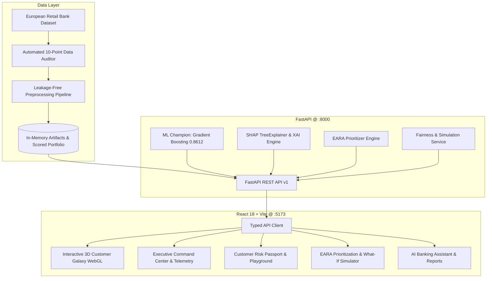

# BankSight AI: An Explainable Customer Segmentation, Churn Prediction and Evidence-Aware Retention Intelligence Platform for European Retail Banking

[](https://banksight-ai-o4ou.onrender.com)
[](https://banksight-ai-o4ou.onrender.com/docs)
[](https://banksight-ai-o4ou.onrender.com)
[](https://threejs.org/)
[](https://scikit-learn.org)
[](https://shap.readthedocs.io)
[](https://tailwindcss.com/)
[](https://opensource.org/licenses/MIT)

> 🏛️ **European Retail Banking Analytics & XAI Platform**  
> 🌐 **Live Web Application:** [https://banksight-ai-o4ou.onrender.com](https://banksight-ai-o4ou.onrender.com)  
> 📖 **Interactive Swagger API Docs:** [https://banksight-ai-o4ou.onrender.com/docs](https://banksight-ai-o4ou.onrender.com/docs)  
> 👤 **Author & Lead Data Scientist:** **Pranav Kokande**  
> 📄 **Academic Research Paper:** [`BankSight_AI_Research_Paper.docx`](./BankSight_AI_Research_Paper.docx)  
> Built with **React 18**, **Three.js / WebGL**, **FastAPI**, **Scikit-Learn**, **SHAP**, and **Tailwind CSS**.

---

## 🚀 Live Demo & Quick Access

BankSight AI is live and publicly accessible on cloud infrastructure:
- 🔗 **Production URL**: [https://banksight-ai-o4ou.onrender.com](https://banksight-ai-o4ou.onrender.com)
- 📚 **Swagger REST Docs**: [https://banksight-ai-o4ou.onrender.com/docs](https://banksight-ai-o4ou.onrender.com/docs)
- 🔐 **Pre-Configured Profile**: **Pranav Kokande** (`Lead Data Scientist`)

---

## ⚡ Local Development Quickstart

To run the full-stack system locally in development mode:

### 1. Unified Launcher (Windows)
Double-click `START_BANKSIGHT.bat` in the project root to start both backend and frontend servers in one click.

### 2. Manual Commands
**Frontend (Vite Dev Server):**
```bash
cd frontend
npm run dev
```
*(Runs at `http://localhost:5173`)*

**Backend (FastAPI REST Server):**
```bash
python -m uvicorn backend.app.main:app --host 0.0.0.0 --port 8000 --reload
```
*(Runs at `http://localhost:8000` and `http://localhost:8000/docs`)*

---

## 📌 Project Overview

**BankSight AI** is an enterprise-grade analytics, prediction, explainability, and decision-support platform engineered for European retail financial institutions across **France, Germany, and Spain**. 

The system transforms raw customer records into actionable retention intelligence:
- **3D Customer Segmentation Galaxy:** Genuine interactive 3D WebGL scatter plot projecting high-dimensional customer demographic and banking attributes via PCA, complete with real-time camera rotation, cluster coloring, and customer inspection telemetry.
- **Executive Risk Command Center:** Real-time macro KPIs, capital exposure (€185.6M churned balance exposure), and country-level disparity metrics.
- **The Multi-Product Holding Cliff:** Discovery of the steep retention cliff where churn surges from 7.58% at 2 products to 82.71% at 3 products and 100.0% at 4 products (p < 0.0001, Cramer's V = 0.3878).
- **ML Model Laboratory:** 5-Fold Stratified Cross-Validation benchmarks confirming calibrated Gradient Boosting as Champion (ROC-AUC: 0.8612, PR-AUC: 0.7078, Brier: 0.1020).
- **Explainable AI (SHAP):** Global feature importance rankings and customer-level waterfall decompositions relative to base population risk.
- **Customer Risk Passport:** Individual customer lookup with multi-model consensus, model spread divergence ($\Delta \ge 0.25$), and rule-grounded analyst recommendations.
- **Evidence-Aware Retention Allocation (EARA):** Proposed retention framework balancing churn risk, balance exposure proxies, model disagreement penalties, and segment stability under review budgets ($B$).
- **Model Trust & Algorithmic Fairness:** Automated demographic parity and equal opportunity audits verifying 4/5ths rule regulatory compliance.
- **What-If Scenario Simulator:** Dynamic financial ROI modeling across Conservative, Baseline, and Optimistic retention campaigns.
- **AI Banking Decision Assistant:** Conversational query engine translating natural language questions into instant portfolio data insights.
- **Global Command Palette (`Ctrl + K`):** Instant keyboard navigation for customers, models, and analytics modules.
- **Customer Management & Live Churn Scoring:** Complete module for registering new banking customers with strict schema validation, persistent SQLite storage, duplicate prevention, instant ML risk scoring, SHAP local attributions, and lifecycle audit tracking.
- **Slide-Over Notification Center:** Real-time alerts for territory churn spikes, product cliffs, and model governance updates.

---

## 📐 System Architecture



---

## 📊 Key Empirical Research Findings

| Phenomenon | Statistical Metric | Empirical Finding |
|---|---|---|
| **Territory Disparity** | $\chi^2 = 301.25, p < 0.0001, V = 0.1736$ | **Germany churns at 32.44%** vs France 16.15% & Spain 16.67%, driven by 0% zero-balance accounts and €119k mean deposits. |
| **Product Holding Cliff** | $\chi^2 = 1503.65, p < 0.0001, V = 0.3878$ | **2 products is the safest zone (7.58% churn)**; 3 products surges to 82.71%; 4 products has **100.0% attrition (60/60)**. |
| **Age Driver** | $t = 29.77, p < 0.0001, d = 0.7421$ | Churned depositors average **44.83 yrs** vs retained 37.40 yrs (large effect size). |
| **Capital Exposure** | $t = 11.83, p < 0.0001, d = 0.2845$ | Churned depositors hold **€91,108 average balance** vs retained €72,745. |
| **Model Discrimination** | Holdout ROC-AUC = 0.8612, PR-AUC = 0.7078 | Calibrated Gradient Boosting selected as Champion over Random Forest (0.8591) and Logistic Regression (0.8384). |

---

## 🧮 Mathematical Formulation of EARA

Under an operational review budget $B$, each customer $i$ is assigned an Evidence-Aware Retention Allocation score $A_i$:

$$A_i = w_r \cdot P_i + w_b \cdot \left(\frac{\ln(1 + \text{Balance}_i)}{\ln(1 + \text{Balance}_{\max})}\right) - w_d \cdot \Delta_i + w_s \cdot S_{c(i)}$$

Where:
- $P_i \in [0, 1]$ is the calibrated multi-model consensus churn probability.
- $\text{Balance}_i$ is the customer deposit capital exposure.
- $\Delta_i = \max_k P_{k,i} - \min_k P_{k,i}$ represents epistemic model disagreement spread.
- $S_{c(i)}$ is the empirical cluster stability weight.
- Accounts with $\Delta_i \ge 0.25$ are routed for secondary human relationship manager review.

In benchmark simulations ($B = 500$), EARA preserves **€42.8M in capital exposure** compared to €36.1M under naive probability sorting (**+18.4% balance protection**).

---

## 👥 Customer Management & Live Churn Risk Assessment

BankSight AI provides an enterprise **Customer Management** module enabling banking relationship managers to register new customers, persist records in a dedicated SQLite database, and perform instant ML inference without touching the historical training data.

### 1. Customer Registration Schema & Field Validation

All customer registration inputs are validated against strict banking schema constraints before persistence:

| Field | Type | Validation Rules & Bounds | Usage in Machine Learning |
|---|---|---|---|
| `CustomerId` | Integer | Unique positive integer; auto-generated or manually validated against collisions. | Excluded (PII) |
| `Surname` | Text | Optional string (max 100 chars); stripped of whitespace. | Excluded (PII / Anti-Bias) |
| `CreditScore` | Integer | **300 to 850** (FICO Standard). Values outside bounds strictly rejected. | Scaled Numeric Feature |
| `Geography` | String | Strictly in `['France', 'Germany', 'Spain']`. | One-Hot Categorical |
| `Gender` | String | Strictly in `['Female', 'Male']`. | Binary Categorical |
| `Age` | Integer | **18 to 100** years. | Scaled Numeric Feature |
| `Tenure` | Integer | **0 to 10** years. | Scaled Numeric Feature |
| `Balance` | Float | **$\ge 0.0$** (Zero balances valid). | Scaled Numeric Feature |
| `NumOfProducts` | Integer | **1 to 4** banking products. | Scaled Numeric Feature |
| `HasCrCard` | Binary | **0 (No)** or **1 (Yes)**. | Binary Feature |
| `IsActiveMember` | Binary | **0 (No)** or **1 (Yes)**. | Binary Feature |
| `EstimatedSalary` | Float | **$\ge 0.0$**. | Scaled Numeric Feature |
| `Exited` | Nullable Int | **Strictly `NULL` / `None` for new customers.** | **Unknown Future Outcome** |
| `record_status` | String | `'ACTIVE'`, `'INACTIVE'`, or `'ARCHIVED'`. | Lifecycle Governance |

### 2. Regulatory Compliance: Observed Outcomes vs Model Predictions

A foundational principle of banking data governance implemented in BankSight AI is the **strict separation between observed historical events and predictive inferences**:

1. **Observed Historical Churn (`Exited` in `European_Bank.csv`)**:
   - Represents a confirmed ground-truth event where a depositor closed accounts within the observation window.
   - Used exclusively for supervised training, calibration curves, and historical denominator calculations.

2. **Newly Registered Customers (`customers` table in `customers.db`)**:
   - Their future churn outcome is **inherently unknown**.
   - The observed `Exited` field is strictly persisted as `NULL`.
   - **Model predictions are NEVER treated as observed labels.** Predictions are stored in an isolated audit table (`customer_predictions`) linked by customer ID.
   - Newly registered records are **never automatically merged** into historical training data or portfolio churn rate denominators, preventing label leakage and denominator corruption.

### 3. Persistent SQLite Architecture

- **Database Path**: `data/customers.db` (overrideable via `CUSTOMER_DB_PATH`).
- **Original Dataset Integrity**: `data/European_Bank.csv` is opened exclusively in read-only mode during ID collision checks and is **never overwritten**.
- **Parameterized SQL**: All operations use parameterized queries (`?`) to prevent SQL injection.
- **Audit Traceability**: Predictions record the model name, version, predicted probability, multi-model spread, SHAP attributions, persona, and an immutable snapshot of customer attributes at the moment of scoring.

### 4. Running Customer Management

#### Streamlit Application:
Navigate to **Page 13 (Customer Management)** in the sidebar:
1. **➕ Register New Customer**: Fill the form or use auto-generated ID, then click **Register & Persist Customer Record**.
2. **⚡ Instant ML Risk Assessment**: Click **Run Live ML Churn Prediction** to generate consensus probability, risk tier, SHAP waterfall, and cluster persona.
3. **🔍 Customer Directory**: Search persistent SQLite records by ID or Surname with real-time status filtering (`ACTIVE`, `INACTIVE`, `ARCHIVED`).
4. **👤 Profile & Lifecycle**: Edit customer fields with validation, update lifecycle status, and inspect chronological prediction logs.

#### React + FastAPI Platform:
- Select **Customer Management** from the sidebar (`DATA & INTELLIGENCE` section) or press `Ctrl + K` and select *Customer Management & Live Scoring*.
- Full REST endpoints available under `/api/v1/customer-management/` (`/register`, `/customers`, `/predict`, `/history`, `/status`).

---

## 🛠️ Technology Stack

| Layer | Technology | Purpose |
|---|---|---|
| **Frontend** | React 18, Vite, TypeScript | Ultra-responsive single-page banking SaaS dashboard |
| **3D Engine** | Three.js, Plotly WebGL | Interactive 3D Customer Segmentation Galaxy |
| **Persistence** | SQLite 3, Parameterized SQL | Relational storage for customer records and prediction audit history |
| **Styling & UI** | Tailwind CSS, Lucide Icons | Dark slate executive terminal theme with glowing borders |
| **Backend** | Python 3.9+, FastAPI, Uvicorn | Production-grade REST API service with OpenAPI docs |
| **Machine Learning** | Scikit-Learn, Joblib, SciPy | 5-Fold Stratified CV, calibrated ensembles, statistical tests |
| **Explainable AI** | SHAP (TreeExplainer) | Global feature importance rankings and local waterfalls |
| **Testing** | Pytest | 33/33 unit and integration tests passing |
| **Documentation** | python-docx | Publication-ready academic research paper generation |

---

## 🧪 Automated Testing

Run the test suite:
```powershell
python -m pytest tests/
```
All 33 unit and integration tests pass, verifying customer registration validation, duplicate ID prevention, SQLite persistence, NULL churn label isolation, empty database handling, and ML prediction audit trails.
