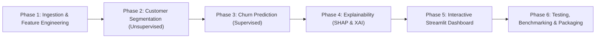
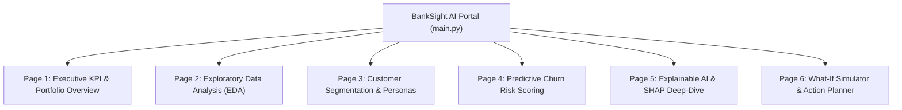

# BankSight AI — Implementation Plan & Architecture Specification
**Explainable Customer Segmentation & Churn Analytics Platform for European Banking**  
*Final-Year Engineering Capstone Project*

---

## 1. Executive Summary & Verified Dataset Audit

### 1.1 Dataset Verification & Schema Audit
The primary dataset `data/European_Bank.csv` was verified and successfully ingested. The dataset contains **10,000 rows** and **14 columns** capturing demographic, financial, and behavioral attributes of bank retail customers across three European territories.

| Column Name | Data Type | Null Count | Unique Values | Description / Role |
| :--- | :--- | :--- | :--- | :--- |
| `Year` | `int64` | 0 (0.0%) | 1 (`2025`) | Static snapshot year. Constant feature across all records. |
| `CustomerId` | `int64` | 0 (0.0%) | 10,000 | Primary key. Unique customer identifier. |
| `Surname` | `object` | 0 (0.0%) | 2,932 | Customer surname. High-cardinality nominal string (PII). |
| `CreditScore` | `int64` | 0 (0.0%) | 460 | Numerical score ranging from 350 to 850 (Mean: 650.53, Median: 652). |
| `Geography` | `object` | 0 (0.0%) | 3 | Territorial market: France (50.14%), Germany (25.09%), Spain (24.77%). |
| `Gender` | `object` | 0 (0.0%) | 2 | Male (5,457 / 54.57%), Female (4,543 / 45.43%). |
| `Age` | `int64` | 0 (0.0%) | 70 | Customer age ranging from 18 to 92 (Mean: 38.92, Median: 37). |
| `Tenure` | `int64` | 0 (0.0%) | 11 | Number of years with bank (0 to 10 years, Mean: 5.01). |
| `Balance` | `float64` | 0 (0.0%) | 6,382 | Account balance in EUR (Range: 0.00 to 250,898.09, Mean: €76,485.89). |
| `NumOfProducts` | `int64` | 0 (0.0%) | 4 | Discrete count of active banking products held (1, 2, 3, or 4). |
| `HasCrCard` | `int64` | 0 (0.0%) | 2 | Binary credit card ownership indicator (1: 70.55%, 0: 29.45%). |
| `IsActiveMember`| `int64` | 0 (0.0%) | 2 | Binary engagement indicator (1: 51.51%, 0: 48.49%). |
| `EstimatedSalary`| `float64` | 0 (0.0%) | 9,999 | Estimated annual income in EUR (Range: 11.58 to 199,992.48). |
| `Exited` *(Target)* | `int64` | 0 (0.0%) | 2 | Churn outcome: 0 = Retained (7,963 / 79.63%), 1 = Churned (2,037 / 20.37%). |

### 1.2 Target Distribution & Class Imbalance
- **Retained (`Exited = 0`)**: 7,963 customers (**79.63%**)
- **Exited / Churned (`Exited = 1`)**: 2,037 customers (**20.37%**)
- **Imbalance Ratio**: Approximately **3.91 : 1** (or ~4:1).
- **Implication**: Raw accuracy is a misleading performance metric (a trivial majority-class classifier achieves 79.63% accuracy). The modeling framework must prioritize **PR-AUC, ROC-AUC, Recall (Sensitivity for churners), and F1-Score**, alongside threshold optimization and class-weight balancing (`scale_pos_weight` or focal loss).

### 1.3 Key Statistical Observations & Data Quality Insights
1. **Constant Feature (`Year`)**: Every single customer has `Year = 2025` (zero variance, standard deviation = 0.0). This feature provides no discriminative value and will be pruned during data preprocessing.
2. **Zero Duplicate Records**: Both full-row duplicates (`0`) and `CustomerId` duplicates (`0`) are absent, confirming referential integrity.
3. **Absence of Missing Values**: The dataset is completely populated with zero `NaN` / `null` values across all 14 attributes.
4. **Bimodal Distribution in Account Balance (`Balance`)**:
   - Exactly **3,617 customers (36.17%)** have a balance of exactly `€0.00`.
   - **Crucial Geographic Dependency**: 48.23% of French customers and 48.41% of Spanish customers hold zero balance, whereas in Germany **0.00%** hold zero balance (100% of German customers hold non-zero balances).
   - Customers with non-zero balances exhibit a churn rate of **24.08%**, compared to **13.82%** for zero-balance customers.
5. **Extreme Churn Non-Linearity on `NumOfProducts`**:
   - `1 product`: 5,084 customers — 27.71% churn
   - `2 products`: 4,590 customers — **7.58% churn** (highest retention)
   - `3 products`: 266 customers — **82.71% churn** (severe churn risk)
   - `4 products`: 60 customers — **100.00% churn** (all 60 customers exited)
   - This non-linear relationship will require tree-based ensemble models or polynomial/discretized features to capture properly.
6. **Geographic Risk Disparity**:
   - Germany: Churn rate of **32.44%** (nearly double France at 16.15% and Spain at 16.67%).
7. **Age Cohort Vulnerability**:
   - `< 30 years`: 7.52% churn
   - `30 - 40 years`: 12.09% churn
   - `40 - 50 years`: 33.97% churn
   - `50 - 60 years`: **56.21% churn** (peak vulnerability)
   - `> 60 years`: 24.78% churn
8. **Uniform Salary Distribution**:
   - `EstimatedSalary` is uniformly spread across the span €11.58 to €199,992.48, indicative of synthetic or anonymized benchmark generation.

### 1.4 Data Limitations & Mitigations
- **Cross-Sectional Static Snapshot**: Lacks temporal transaction histories, frequency of app logins, customer support interactions, or macroeconomic indicators (e.g., ECB interest rates).  
  *Mitigation*: Engineer behavioral proxy indicators (e.g., balance-to-salary ratio, product density, credit-to-age ratio, inactivity flags).
- **PII & Identifier Features**: `CustomerId` and `Surname` carry data leakage and ethical risks.  
  *Mitigation*: Explicitly drop `CustomerId` and `Surname` from model training feature matrices; retain `CustomerId` only as an audit key for customer lookup.
- **Geographic Bias**: Limited to 3 countries (France, Germany, Spain).  
  *Mitigation*: Stratify all validation splits by `Geography` and `Exited` to maintain representative sub-population metrics.

---

## 2. Proposed Application Architecture

BankSight AI will follow a clean, modular, production-ready architecture separating data engineering, machine learning pipelines, explainability engines, and UI presentation layers.

```
BankSight-AI/
│
├── data/
│   ├── European_Bank.csv              # Raw primary dataset
│   └── processed/                     # Preprocessed features, train/test splits (generated)
│
├── models/                            # Serialized artifacts (.joblib / .json)
│   ├── churn_classifier.joblib        # Best calibrated churn model
│   ├── scaler_transformer.joblib      # Feature encoders & scalers pipeline
│   ├── cluster_pipeline.joblib        # K-Means / PCA segmentation pipeline
│   └── explainer.joblib               # SHAP TreeExplainer artifact
│
├── src/
│   ├── __init__.py
│   ├── config.py                      # Global configuration, paths, seeds, thresholds
│   ├── data_loader.py                 # Ingestion, validation, and schema enforcement
│   ├── preprocessing.py              # Cleaning, feature engineering, transformations
│   ├── segmentation.py                # RFM-style banking clustering (K-Means, PCA, silhouette)
│   ├── churn_model.py                 # Supervised training, cross-validation, hyperparam tuning
│   ├── explainability.py              # SHAP values, feature attributions, waterfall generators
│   └── simulation.py                  # What-if scenario analysis and retention strategy logic
│
├── app/
│   ├── main.py                        # Streamlit application entry point & navigation
│   ├── components/                    # Reusable UI widgets (cards, badges, metric tiles)
│   │   ├── __init__.py
│   │   ├── metrics.py
│   │   └── charts.py
│   └── pages/                         # Multi-page dashboard views
│       ├── 1_Executive_Overview.py    # Macro KPIs & Portfolio Churn Dynamics
│       ├── 2_Exploratory_EDA.py       # Demographic & Financial Distribution Explorer
│       ├── 3_Customer_Segments.py     # Unsupervised Clusters & Persona Profiling
│       ├── 4_Churn_Prediction.py      # Individual & Batch Risk Scoring
│       ├── 5_Explainable_AI.py        # Global & Local SHAP Interpretability Deep-Dive
│       └── 6_What_If_Simulator.py     # Retention Strategy Simulator & Action Planner
│
├── tests/                             # Comprehensive automated test suite
│   ├── __init__.py
│   ├── test_data_loader.py
│   ├── test_preprocessing.py
│   ├── test_segmentation.py
│   ├── test_churn_model.py
│   └── test_explainability.py
│
├── requirements.txt                   # Frozen dependency specifications
├── implementation_plan.md             # This architecture & roadmap document
└── README.md                          # Project documentation & presentation guide
```

---

## 3. Development Phases & Milestones

The project will proceed across six structured phases designed for thorough verification, modular development, and seamless capstone evaluation:



### Phase 1: Robust Data Pipeline & Feature Engineering
- Ingest `data/European_Bank.csv` with strict dtype casting and validation assertions.
- Feature Pruning: Remove uninformative columns (`Year`, `Surname`, `CustomerId` for training).
- Feature Creation:
  - `BalanceSalaryRatio = Balance / (EstimatedSalary + 1e-6)`
  - `AgeGroup`: Categorical bucketed cohorts (`<30`, `30-40`, `40-50`, `50-60`, `60+`)
  - `IsZeroBalance`: Indicator flag (`Balance == 0.0`)
  - `CreditScoreAgeRatio = CreditScore / Age`
  - `ProductPerTenure = NumOfProducts / (Tenure + 1)`
  - `HighRiskSegment`: Interaction term between Germany geography, Age > 45, and NumOfProducts > 2.
- Preprocessing Pipeline:
  - One-Hot Encoding for `Geography` and `Gender` (`drop='first'` or full dummy with readable names).
  - Robust or Standard Scaling for skewed continuous variables (`Balance`, `EstimatedSalary`, `CreditScore`, `Age`).
  - Scikit-learn `Pipeline` and `ColumnTransformer` encapsulation to prevent data leakage during CV.

### Phase 2: Unsupervised Customer Segmentation (Clustering)
- Feature set selection focused on behavioral and financial value (`Balance`, `EstimatedSalary`, `NumOfProducts`, `IsActiveMember`, `CreditScore`, `Tenure`).
- Dimensionality reduction via **PCA (Principal Component Analysis)** for 2D/3D visualization and variance explanation.
- Clustering algorithms:
  - **K-Means Clustering** with Elbow Method (Inertia) and Silhouette Analysis ($k \in [3, 6]$).
  - Alternative evaluation with Agglomerative Hierarchical Clustering or DBSCAN.
- Banking Persona Profiling:
  - *Cluster 0: Affluent Inactive Savers* (High balance, low activity, high churn risk).
  - *Cluster 1: Young Digital Natives* (Low balance, high product count, moderate churn).
  - *Cluster 2: Retained Multi-Product Families* (Moderate balance, 2 products, high activity).
  - *Cluster 3: Senior High-Net-Worth VIPs* (High balance, high salary, age > 50).

### Phase 3: Supervised Churn Prediction Modeling
- Problem Formulation: Binary classification on `Exited`.
- Splitting: Stratified 80/20 train/test split, preserved across all downstream benchmarks.
- Model Candidates:
  1. Baseline: Logistic Regression (L2 penalized).
  2. Balanced Random Forest Classifier.
  3. Gradient Boosting Classifier (Scikit-Learn `HistGradientBoostingClassifier`).
  4. XGBoost / LightGBM / CatBoost (with `scale_pos_weight` tuned for class imbalance).
- Optimization & Cross-Validation:
  - 5-Fold Stratified Cross-Validation.
  - Hyperparameter tuning via `Optuna` or `GridSearchCV` / `HalvingRandomSearchCV`.
  - Calibration: Probability calibration (`CalibratedClassifierCV` with isotonic or sigmoid regression) to ensure predicted probabilities match real empirical risk frequencies.
- Evaluation Metrics:
  - ROC-AUC, PR-AUC (Precision-Recall AUC), Recall (at fixed 80% recall threshold), F1-Score, Brier Score, and Confusion Matrix.

### Phase 4: Model Explainability & Interpretability (XAI)
- **Global Explainability**:
  - Tree-based SHAP (`shap.TreeExplainer`) for fast exact Shapley calculations.
  - Summary Beeswarm plot: feature magnitude vs. directional impact on churn.
  - Global Feature Importance bar charts comparing SHAP values vs. Gini impurity.
  - Partial Dependence Plots (PDP) for non-linear variables (`Age`, `NumOfProducts`, `Balance`).
- **Local / Individual Explainability**:
  - Customer-specific SHAP Waterfall plots and Force plots for real-time scoring.
  - Human-readable natural language reason generator (e.g., *"Customer churn risk is 78%, driven primarily by Germany residence (+22%), holding 3 products (+31%), and age 52 (+15%)"*).
- **Counterfactual Guidance**:
  - Actionable what-if recommendations (e.g., *"If customer becomes active (IsActiveMember = 1) and consolidates products to 2, predicted churn risk drops from 78% to 18%"*).

### Phase 5: Multi-Page Streamlit Analytics Application
- Modern, professional, banking-grade Streamlit application styled with a cohesive European banking theme (navy, slate, emerald, crimson accents).
- Fully responsive sidebar navigation, interactive filters (Geography, Age range, Products), cached data loaders (`@st.cache_data`, `@st.cache_resource`).
- Seamless interactive visual charts via Plotly / Altair.

### Phase 6: System Testing, Validation & Final Packaging
- Unit and integration tests for data ingestion, feature pipeline, segmentation, and inference.
- Code documentation, docstrings, type annotations, and academic capstone report alignment.

---

## 4. Required Python Libraries & Environment Strategy

### Currently Installed in Environment
- `pandas` (2.3.3) — Core data manipulation & tabulations
- `numpy` (2.0.2) — Numerical operations & vectorization
- `scikit-learn` (1.6.1) — Preprocessing, pipelines, K-Means, PCA, Random Forest, metrics
- `streamlit` (1.50.0) — Modern web dashboard framework
- `altair` (5.5.0) — Declarative interactive chart grammar
- `matplotlib` (3.9.4) — Static plot generation
- `scipy` (1.13.1) — Statistical distributions and hypothesis testing
- `joblib` (1.5.3) — Model persistence and serialization

### Libraries to Add for Full Production Implementation
- `xgboost` / `lightgbm` — High-performance gradient boosted decision trees for tabular churn data
- `shap` (0.44+) — SHapley Additive exPlanations for global & local model interpretability
- `plotly` (5.18+) — Dynamic interactive charts for Streamlit (radar charts, 3D PCA clusters, waterfall plots)
- `seaborn` — Statistical visualizations and heatmaps
- `pytest` — Automated unit and integration testing suite

---

## 5. Detailed Streamlit Dashboard Specification



### Page 1: Executive KPI & Portfolio Overview (`1_Executive_Overview.py`)
- **Top Metrics Row**: Total Customer Base (10,000), Overall Churn Rate (20.37%), Capital at Risk (€764.8M total balance), High-Risk Customer Count.
- **Geographic Breakdown**: Interactive choropleth / bar comparison of customer density and churn rates across France, Germany, and Spain.
- **Risk Distribution Heatmap**: Churn intensity indexed across Age cohorts vs. Number of Products.
- **Key Takeaways Callout**: Automated high-level executive briefing summarizing portfolio hotspots.

### Page 2: Exploratory Data Analysis & Demographics (`2_Exploratory_EDA.py`)
- **Bivariate & Univariate Distribution Views**:
  - Interactive histograms and KDE plots for `CreditScore`, `Age`, `Balance`, `EstimatedSalary`.
  - Categorical breakdowns for `Gender`, `HasCrCard`, `IsActiveMember`, and `Geography`.
- **Zero-Balance Anomaly Deep-Dive**: Visualizing the 36.17% zero-balance spike and its regional concentration in France and Spain versus Germany.
- **Correlation Matrix**: Interactive correlation heatmap showing linear and rank relationships between features and `Exited`.

### Page 3: Customer Segmentation & Behavioral Clusters (`3_Customer_Segments.py`)
- **Cluster Visualizer**: 2D and 3D interactive scatter plots powered by PCA showing customer cluster separation.
- **Cluster Diagnostics**: Silhouette scores, inertia curves, and cluster size distributions.
- **Persona Radar Charts**: Multi-attribute spider charts comparing cluster centers across Normalized Balance, Salary, Credit Score, Activity, and Product Count.
- **Segment Retention Matrix**: Churn rates across clusters with strategic positioning recommendations.

### Page 4: Predictive Churn Analytics & Risk Scoring (`4_Churn_Prediction.py`)
- **Customer Lookup & Individual Risk Profile**:
  - Search by `CustomerId` or select representative customer archetypes.
  - Gauge chart displaying predicted churn probability (Low: < 25%, Moderate: 25-50%, High: > 50%).
- **Batch Customer Scoring**:
  - Filter customer subsets (e.g. German customers aged 45-60 with > 2 products) and generate sorted risk priority worklists.
  - CSV export of high-risk customers for branch relationship managers.
- **Model Performance Benchmark Card**:
  - Tabbed comparison of ROC curves, Precision-Recall curves, and Confusion Matrices across evaluated algorithms.

### Page 5: Explainable AI & SHAP Interpretability (`5_Explainable_AI.py`)
- **Global Model Transparency**:
  - SHAP summary beeswarm plot detailing top positive/negative drivers of churn across the entire portfolio.
  - Feature importance ranking with business-friendly explanations.
  - Partial dependence curves showing exact inflection points (e.g. churn risk inflection at Age > 42).
- **Individual Customer Attribution**:
  - Interactive SHAP waterfall plot explaining *why* an individual customer received their specific risk score.
  - Plain-language narrative breakdown for non-technical bank relationship managers.

### Page 6: What-If Scenario Simulator & Retention Planner (`6_What_If_Simulator.py`)
- **Interactive Parameter Sliders**:
  - Adjust customer attributes in real time (e.g. offer a fee-free credit card, incentivize second product adoption, activate digital engagement, increase balance).
- **Dynamic Delta Readout**:
  - Instant re-scoring displaying $\Delta \text{Churn Probability}$ and net risk mitigation.
- **Prescriptive Next-Best-Action (NBA)**:
  - Algorithm-guided recommendations tailored to customer cluster and primary SHAP risk factors.

---

## 6. Testing Strategy & Quality Assurance

To ensure capstone-grade engineering reliability, BankSight AI will incorporate automated test coverage across all critical pipeline components:

1. **Data Ingestion Tests (`tests/test_data_loader.py`)**:
   - Verify file existence, schema integrity, correct column count (14), and row count (10,000).
   - Assert zero missing values and zero duplicate customer IDs.
   - Assert expected target class values are strictly $\in \{0, 1\}$.
2. **Feature Engineering Tests (`tests/test_preprocessing.py`)**:
   - Verify uninformative columns (`Year`, `CustomerId`, `Surname`) are cleanly dropped from model inputs.
   - Test numerical feature transformations and ratio calculations for division-by-zero resilience.
   - Assert no target leakage in training transformers.
3. **Clustering Pipeline Tests (`tests/test_segmentation.py`)**:
   - Verify K-Means convergence and expected cluster label bounds ($0$ to $k-1$).
   - Test PCA transformation dimensions and explained variance ratio properties.
4. **Churn Model Tests (`tests/test_churn_model.py`)**:
   - Verify model predicts valid probabilities strictly within $[0.0, 1.0]$.
   - Check stratified cross-validation split balance.
   - Verify model serialization (`joblib.dump` / `joblib.load`) roundtrip fidelity.
5. **Explainability Tests (`tests/test_explainability.py`)**:
   - Assert SHAP output dimensions match input customer feature dimensions.
   - Verify base value + sum of SHAP values equals model log-odds / margin output.
6. **Streamlit Smoke Tests**:
   - Validate error-free execution of multi-page modules using Streamlit's testing framework (`AppTest`).

---

## 7. Next Steps & Approval Gate

With the dataset verified, statistical realities confirmed, and the architectural blueprint established, implementation can proceed upon approval:
- **Phase 1 Execution**: Setting up modular project directory structure, `requirements.txt`, configuration, and preprocessing pipelines.
- **Baseline Modeling & Clustering**: Building the segmentation engine and benchmark churn classifiers with cross-validation.
